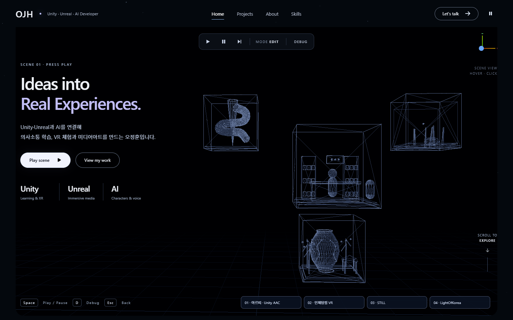

<div align="center">

# OJH — Unity / Unreal Interactive Portfolio

**오정훈의 인터랙티브 포트폴리오 사이트 · https://jeonghun267.github.io/**




</div>

---

## 소개

게임 엔진 에디터처럼 **EDIT → PLAY** 를 누르면 Unity·Unreal 프로젝트 4개가 담긴 3D 미니 큐브가 깨어나는 포트폴리오입니다. 아래 카드 목록에는 웹 프로젝트까지 5개를 소개합니다.
큐브나 아래 바로가기를 누르면 프로젝트 상세 창(역할, AI 활용, 문제 해결, 대표 화면, 시연 영상)이 열립니다.

| 프로젝트 | 형태 | 내용 |
|---|---|---|
| **아르띠 · Unity AAC** | 3인 협업 (졸업작품) | 편의점 말하기 훈련, 현장 의사소통 지원, 프로필, 학습 리포트 |
| **인체탐험 VR** | 개인 | 소화기관 체험, 보트 이동, 가이드 NPC, OSC/NDI |
| **STILL** | 개인 | Meta Quest 수중 관찰, 보이드 군집, Gemini 설명과 TTS, 관찰 일지 |
| **LightOfKorea** | 개인 | Unreal 60초 미디어아트 오프닝, 재질·Sequencer·Niagara·Python 자동화 |
| **ReLo** | 2인 협업 | 해외 직구 반품·환불 기록 웹 서비스, React 19·Node.js·SQLite·Gemini (웹 구현, 배포 전) |

## 주요 기능

- **3D 히어로 씬** (`hero3d.js`): Three.js로 만든 프로젝트별 미니 큐브 4개. EDIT 모드에서 시작하고 Play를 누르면 색·빛·움직임이 켜집니다.
- **성능 배려**: 기기 픽셀 비율은 1.5까지로 제한하고, 좁은 화면에서는 블룸을 끕니다. 모션 줄이기 설정이나 탭이 숨겨진 상태, 상세 창이 열린 상태에 맞춰 시뮬레이션을 멈춥니다.
- **키보드 조작**: `Space` 재생/정지, `D` 디버그, `Esc` 뒤로.
- **프로젝트 카드와 필터** (`app.js`): 상세 창에서 영상을 자동 재생하지 않고, 창을 닫으면 재생을 멈춥니다.
- **콘텐츠 분리** (`config.js`): 프로젝트 소개·역할·링크·미디어를 데이터 파일 하나로 관리합니다.
- **빌드 도구 없이 실행**: ES 모듈과 importmap만 사용합니다.

## 실행

Node.js 18.18 이상이 필요하고, 추가 패키지는 설치하지 않습니다.

```bash
npm run dev
```

http://127.0.0.1:4173 에서 열립니다.

## 검사

```bash
npm run check
```

```bash
python tests/smoke_test.py
```

브라우저 검사에는 Playwright와 Chromium이 필요합니다(`CHROMIUM_PATH`로 경로 지정 가능). 결과는 [docs/design-qa.md](docs/design-qa.md)에 기록합니다.

## 구조

```
index.html / styles.css   # 레이아웃, 반응형
app.js                    # 카드, 필터, 상세 창, 키보드·모션 설정
hero3d.js                 # Three.js 3D 히어로 씬
config.js                 # 프로젝트 데이터
assets/media/             # 실제 프로젝트 화면·시연 영상
vendor/                   # Three.js r170과 애드온
server.mjs                # 로컬 미리보기 서버
tests/smoke_test.py       # 브라우저 회귀 검사
```

## 배포와 자료

- GitHub Pages가 `main` 브랜치 루트를 제공합니다. 미디어는 저장소에서 직접 호스팅하고, AAC 시연만 YouTube를 씁니다.
- API 키·토큰·임시 서명 주소는 코드에 저장하지 않습니다. 비공개 저장소 링크는 사이트에 노출하지 않습니다.
- 이미지·영상 출처는 [SOURCES.md](SOURCES.md), 외부 코드 라이선스는 [NOTICE.md](NOTICE.md)에 있습니다.

## 개발 흐름

- `jeonghun` 브랜치에서 작업하고, `npm run check`와 브라우저 검사로 에러가 없는지 확인한 뒤 `main`에 머지합니다.
- `main`은 항상 배포 가능한 상태로 유지합니다 (`main` = 실제 사이트).
