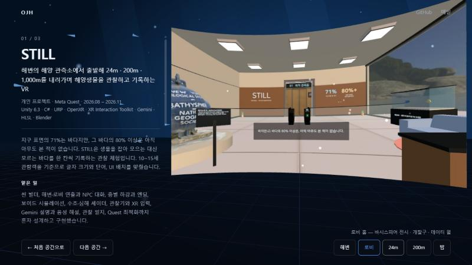

# 오정훈 포트폴리오

https://jeonghun267.github.io/



스크롤 없이 한 화면에서 공간을 오가는 포트폴리오입니다. 처음 공간에는 소개 글과 문 세 개가 있고, 문을 누르면 그 프로젝트의 공간으로 들어갑니다.

| 공간 | 프로젝트 | 분위기 |
|---|---|---|
| 01 | STILL — 해양생물을 관찰하고 기록하는 Meta Quest VR | 물속 |
| 02 | 아르띠 — 편의점 대화를 연습하는 AI · AAC 앱 | 가게 |
| 03 | 인체탐험 VR — 치료 잠수정으로 소화기관을 고치는 VR | 몸속 |

## 기능

- 문을 누르면 카메라가 문 안으로 들어가고, 프로젝트 화면은 휘어진 대형 화면에 뜹니다. 탭으로 사진과 영상을 바꿉니다.
- 주소가 공간마다 다릅니다(`#still`, `#aac`, `#humanbody`). 뒤로 가기와 링크 공유가 됩니다.
- 세로 화면에서는 문을 하나씩 넘겨 보고(화살표·밀기), 설명은 아래 판에 나옵니다.
- 모션 줄이기 설정이면 이동 연출과 입자 움직임을 끕니다.
- WebGL을 못 쓰면 같은 내용을 평면 목록으로 보여 줍니다.
- 키보드: `Tab`으로 문 고르기, `Enter`로 들어가기, `Esc`로 처음 공간.

## 실행

Node.js 18.18 이상이 필요합니다. 설치할 패키지는 없습니다.

```bash
npm run dev
```

http://127.0.0.1:4173/index.html 에서 열립니다.

## 구조

```
index.html     # 뼈대
styles.css     # 모양, 세로 화면, 평면 대체 화면
app.js         # 3D 공간, 공간 이동, 화면 탭
config.js      # 소개 글과 프로젝트 내용 (글·링크·자료는 여기서만 고칩니다)
assets/media/  # 프로젝트 사진과 영상
vendor/        # three.js r170
```

## 내용 고치기

`config.js`의 `projects`에서 글과 `media` 목록을 고치면 됩니다. 공간 분위기는 `mood`(`sea` · `store` · `body`)로 고릅니다.

자료 출처는 [SOURCES.md](SOURCES.md), 외부 코드 고지는 [NOTICE.md](NOTICE.md)에 있습니다.
